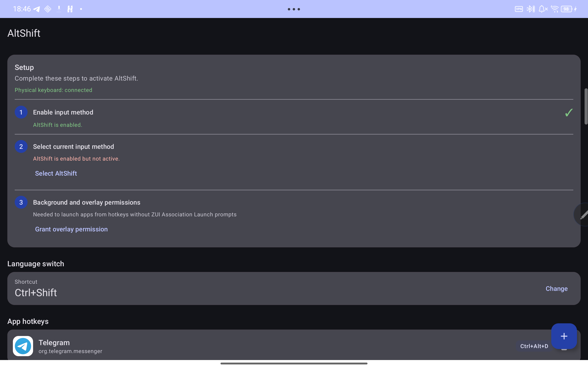

<h3 align="center">AltShift</h3>

<p align="center">
    <strong>
    A crash-resilient hardware keyboard IME for Russian transliteration and app hotkeys.
    </strong>
</p>
<p align="center">
    <a href="#license">
        
    </a>
    <a href="#">
        
    </a>
    <a href="#">
        
    </a>
</p>
<p align="center">
    <a href="#overview">Overview</a> •
    <a href="#features">Features</a> •
    <a href="#requirements">Requirements</a> •
    <a href="#building-from-cli">Building from CLI</a> •
    <a href="#adb-setup">ADB Setup</a> •
    <a href="#configuration">Configuration</a> •
    <a href="#license">License</a>
</p>
<hr>

<p align="center">
    
</p>

A minimal input method service for physical keyboards on Android. AltShift maps Latin scancodes to Cyrillic characters in a single, allocation-free lookup table and launches applications from user-defined hardware key combinations. No cloud services, no telemetry, no background daemons.

## Overview

AltShift is a hardware-first IME. It does not draw a full soft keyboard; it sits between the physical keyboard and the focused application, translates key events when Russian mode is active, and consumes only the combinations explicitly configured by the user. Everything else is passed through untouched. When the physical keyboard disconnects, AltShift offers a one-tap fallback to the system keyboard and prompts to switch back after reconnection.

The service is written in pure Java 21 with native XML views and Material 3 components. Configuration is stored locally in `SharedPreferences` as JSON. The project has no Kotlin source files and no annotation processors.

## Features

- **Russian transliteration**: Standard ЙЦУКЕН mapping with Shift and CapsLock support, including punctuation.
- **Language toggle**: Default `Alt + Shift`, configurable from the settings UI. The OS subtype switcher is bypassed.
- **App hotkeys**: Bind any physical key combination to an installed application.
- **Zero-allocation input loop**: Static primitive-indexed lookup tables and preallocated strings; no iterators, string concatenation, or runtime allocation while typing.
- **Fail-safe service**: External intents and input connection calls are guarded; an IME exception must never take down system input.
- **Guided setup**: A three-step onboarding card verifies IME enablement, active IME selection, and overlay permission.
- **Soft keyboard fallback**: Detects physical keyboard removal and switches to the preferred on-screen keyboard, with a one-tap pill and a reconnection prompt as fallbacks.
- **Native settings**: Material 3 toolbar, setup stepper, hotkey list, key-capture dialog, and application picker.
- **Zero bloat**: No DI framework, no Kotlin, no Compose. `SharedPreferences` and `org.json` only.

## Requirements

- **JDK 21** for compilation and Gradle.
- **Android SDK Platform 34** and **Build-Tools 34.0.0**.
- **ADB** for device installation and IME activation.
- An Android device with a physical keyboard, running Android 8.0 (API 26) or newer.

## Building from CLI

The Gradle wrapper is pinned and committed. Point Gradle at your SDK with `local.properties`:

```properties
sdk.dir=/path/to/Android/Sdk
```

Build the debug APK:

```bash
./gradlew assembleDebug
```

The artifact is written to:

```text
app/build/outputs/apk/debug/app-debug.apk
```

Clean the build outputs:

```bash
./gradlew clean
```

## ADB Setup

Verify that the device is connected:

```bash
adb devices
```

Install or update the debug build:

```bash
adb install -r app/build/outputs/apk/debug/app-debug.apk
```

Enable the input method:

```bash
adb shell ime enable ru.b1sted.altshift/.service.HardwareInputService
```

Select it as the active IME:

```bash
adb shell ime set ru.b1sted.altshift/.service.HardwareInputService
```

List the available and enabled input methods:

```bash
adb shell ime list -a -s
```

The same actions are available from **Settings → System → Languages & input → On-screen keyboard** on the device.

## Configuration

Open **AltShift** from the launcher.

| Setting | Default | Description |
| --- | --- | --- |
| Language switch | `Alt + Shift` | Toggles Russian transliteration. Captured from the next physical combination. |
| App hotkeys | Empty | Each binding maps a modifier mask and key code to an installed application. |

The setup stepper reports whether AltShift is enabled and selected, and offers a one-tap action for each missing requirement. App shortcuts are stored per package and can be removed from the list.

Configuration data lives in the app's private `SharedPreferences` file. Uninstalling the application removes it.

## License

Distributed under the **GNU General Public License v3.0**.

You are free to use, study, modify, and redistribute this software under the terms of the GPLv3. Derivative works must remain under the same license and preserve the copyright notices.

Full text of the license: [LICENSE](./LICENSE).
