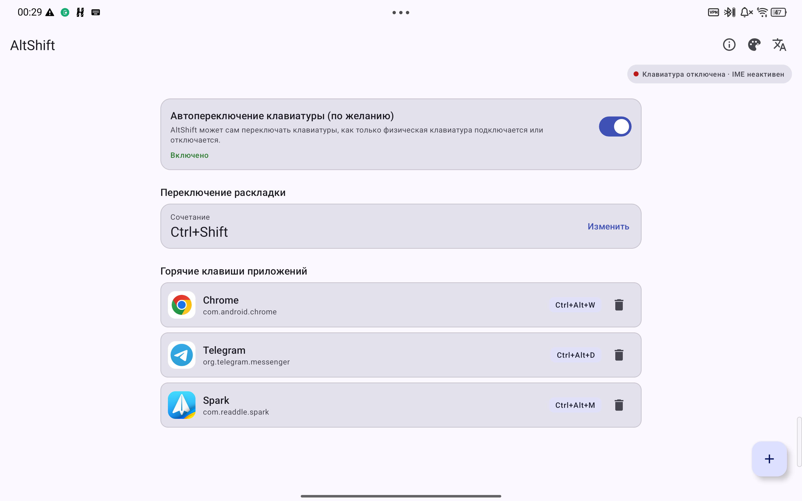

<h3 align="center">AltShift</h3>

<p align="center">
    <strong>
    Лёгкий и отказоустойчивый драйвер физической клавиатуры и менеджер горячих клавиш для Android.
    </strong>
</p>
<p align="center">
    <a href="https://github.com/b1sted/AltShift/actions/workflows/build.yml">
        
    </a>
    <a href="https://github.com/b1sted/AltShift/releases">
        
    </a>
    <a href="#лицензия">
        
    </a>
    <a href="#требования">
        
    </a>
</p>
<p align="center">
    <a href="README.md">English</a> &bull; <strong>Русский</strong>
</p>
<p align="center">
    <a href="#обзор">Обзор</a> &bull;
    <a href="#возможности">Возможности</a> &bull;
    <a href="#фоновый-контроль-watchdog">Watchdog</a> &bull;
    <a href="#потребление-ресурсов">Ресурсы</a> &bull;
    <a href="#проверка-релизов-и-подписи">Проверка релизов и подписи</a> &bull;
    <a href="#требования">Требования</a> &bull;
    <a href="#сборка-из-терминала">Сборка</a> &bull;
    <a href="#настройка-через-adb">Настройка через ADB</a> &bull;
    <a href="#настройки">Настройки</a> &bull;
    <a href="#лицензия">Лицензия</a>
</p>
<hr>

<p align="center"></p>

<p align="center">
    <a href="https://apps.obtainium.imranr.dev/redirect?r=obtainium://app/%7B%22id%22%3A%22ru.b1sted.altshift%22%2C%22url%22%3A%22https%3A%2F%2Fgithub.com%2Fb1sted%2FAltShift%22%2C%22author%22%3A%22b1sted%22%2C%22name%22%3A%22AltShift%22%2C%22additionalSettings%22%3A%22%7B%5C%22apkFilterRegEx%5C%22%3A%20%5C%22%5EAltShift-v%5B0-9.%5D%2B%5C%5C%5C%5C.apk%24%5C%22%7D%22%7D">
        
    </a>
</p>

Минималистичный системный способ ввода (IME) для Android, превращающий аппаратную клавиатуру в полноценное устройство ввода. Без облачных сервисов, аналитики и постоянных фоновых служб.

## Обзор

AltShift (`ru.b1sted.altshift`) — это служба ввода (IME) для устройств с физической клавиатурой. Приложение не рисует экранную клавиатуру, а работает прослойкой между аппаратной клавиатурой и активным окном: переводит нажатия в нужную раскладку, запускает приложения по заданным комбинациям и возвращает экранную клавиатуру при отключении физической. Все остальные сочетания передаются в систему без изменений.

Приложение написано на чистой Java 21 с классическим XML-интерфейсом и компонентами Material 3. Настройки хранятся локально в `SharedPreferences` в формате JSON. В проекте нет Kotlin, Compose, DI-фреймворков и генерации кода. Используются только публичные API AOSP, поэтому одна и та же сборка одинаково работает на Android 8.0+ независимо от производителя и оболочки.

При подключении и отключении физической клавиатуры AltShift умеет автоматически переключать клавиатуры через `WRITE_SECURE_SETTINGS` либо показывать компактную подсказку Dynamic Island для переключения в одно касание. Оба сценария защищены от сбоев: ошибка в IME никогда не «уронит» системный ввод и не оставит пользователя без клавиатуры.

## Фоновый контроль (Watchdog)

Начиная с Android 12, система замораживает кэшированные процессы, когда выгружает службу ввода AltShift (после переключения на другую клавиатуру). Замороженный процесс не получает события от `InputManager.InputDeviceListener`, поэтому при подключении клавиатуры по pogo-pin, док-станции или Bluetooth устройство может остаться на экранной клавиатуре. По той же причине при отключении клавиатуры в шторке могло зависать устаревшее уведомление «AltShift неактивен».

Чтобы решить обе проблемы, AltShift запускает временную foreground-службу (`KeyboardWatchdogService`, `foregroundServiceType="specialUse"`), которая работает только при выполнении **всех** трёх условий:

- мастер первоначальной настройки завершён;
- AltShift включён в системе, но сейчас выбрана другая клавиатура;
- доступен хотя бы один способ переключения или оповещения: автопереключение через `WRITE_SECURE_SETTINGS`, показ поверх других окон (Dynamic Island) или уведомления.

Подключённая физическая клавиатура — не обязательное условие запуска службы. Когда клавиатура отключена, в шторке висит тихий статус «Ожидание физической клавиатуры» (`IMPORTANCE_MIN`). Когда клавиатура подключена, но выбрана другая экранная клавиатура (например, Gboard), показывается статус «Отслеживание подключения клавиатуры» — процесс не замораживается и продолжает получать события. Отключение клавиатуры сразу убирает устаревшее уведомление «AltShift неактивен», а повторное подключение снова выводит Dynamic Island. Как только AltShift возвращается в качестве активного способа ввода, служба мгновенно останавливается и убирает уведомление.

Watchdog не использует таймеры и фоновый опрос (polling), не блокирует переход в сон (wake lock) — он лишь удерживает процесс от заморозки, чтобы система продолжала передавать события подключения и отключения клавиатуры. Пока активен сам AltShift, эта служба не работает вообще.

## Возможности

- **Полноценная русская PC-раскладка (ЙЦУКЕН)**: буквы, знаки препинания и цифровой ряд (`1..0`, `-`, `=`) с правильной работой CapsLock — CapsLock влияет только на буквы и не затрагивает цифры и спецсимволы.
- **Русская локализация и выбор языка приложения**: полный перевод `values-ru` для главного экрана, мастера настройки, диалогов, Dynamic Island, уведомлений и watchdog. По умолчанию язык подстраивается под систему (`en` / `ru`), а в настройках можно выбрать `Как в системе`, `English` или `Русский`. Выбор применяется ко всему приложению, включая уведомления и Dynamic Island, и синхронизируется с системным меню языков приложений на Android 13+.
- **Настраиваемая клавиша переключения раскладки**: по умолчанию между английской и русской раскладками переключает сочетание `Alt + Shift` (комбинацию можно поменять на любую другую прямо с физической клавиатуры). Системное переключение языковых подтипов при этом не используется.
- **Глобальные горячие клавиши для приложений**: привязывайте любые сочетания с модификаторами к установленным приложениям. Перехватываются только назначенные пользователем комбинации; конфликты с клавишей смены раскладки блокируются автоматически.
- **Адаптивный Dynamic Island**: всплывающая капсула Material 3 с поддержкой светлой и тёмной темы, мягкой тенью и кнопкой **Переключить** для вызова системного выбора клавиатуры. На телефонах оставляет аккуратный отступ `16dp` от краёв и переносит текст в две строки без троеточий; на планшетах (`600dp+`) сохраняет компактную ширину `420dp` с текстом в одну строку.
- **Два режима переключения клавиатур**: штатный возврат к экранной клавиатуре при отсоединении физической, плюс опциональное полностью автоматическое переключение в обе стороны при выданном `WRITE_SECURE_SETTINGS`.
- **Временный watchdog переподключения**: `specialUse`-служба удерживает процесс от заморозки только пока активна другая клавиатура и полностью выключается при возврате на AltShift. Подробнее — в разделе [Фоновый контроль (Watchdog)](#фоновый-контроль-watchdog).
- **Пробуждение при разблокировке**: ресивер обрабатывает `BOOT_COMPLETED` и `USER_PRESENT`, пробуждает процесс после разблокировки экрана, восстанавливает AltShift при подключённой клавиатуре и актуализирует состояние watchdog.
- **Разделённые уведомления**: обычный тихий канал `altshift_keyboard_alerts_v2` (`IMPORTANCE_DEFAULT`) показывает смахиваемое напоминание, если закрыть (`[X]`) или проигнорировать Dynamic Island; срочный канал `altshift_keyboard_alerts_urgent` (`IMPORTANCE_HIGH`) выводит heads-up баннер только если пользователь закрыл системное окно выбора клавиатур, так и не переключившись на AltShift.
- **Защита от блокировки ввода**: отдельное предупреждение срабатывает, если AltShift остался единственной включённой клавиатурой в системе — чтобы при отсоединении физической клавиатуры не остаться без экранного ввода.
- **Отказоустойчивость**: все внешние интенты, вызовы `InputConnection` и запись системных настроек обёрнуты в перехват ошибок — сбой не заблокирует ввод в других приложениях.
- **100% универсальный AOSP**: только публичные API без привязки к прошивкам — одинаково работает на планшетах и смартфонах Lenovo, Samsung, Xiaomi, Pixel и других устройствах на Android 8.0+.
- **Интерфейс Material 3**: бейдж состояния, карточка смены раскладки, блок автопереключения с пошаговой ADB-инструкцией, список горячих клавиш, окно захвата комбинаций, список приложений, светлая/тёмная тема и выбор языка.
- **Пошаговый мастер настройки**: три экрана с проверкой всех шагов: включён ли IME, выбран ли AltShift и выданы ли разрешения поверх окон, на уведомления и работу в фоне.
- **Окно «Об AltShift» с диагностикой**: версия, название физической клавиатуры, `VID/PID`, текущий активный IME, режим переключения, ссылка на GitHub и кнопка повторного запуска мастера.
- **Минимальное потребление ресурсов**: чистая Java 21, ~2 МБ Java heap (~10 МБ Java + native heap в режиме набора), 0.0% CPU в простое, ноль телеметрии. Нет доступа к интернету и нет `QUERY_ALL_PACKAGES` — список приложений получается через ограниченный фильтр `<queries>`, названия приложений загружаются в фоне, а иконки подгружаются по мере прокрутки только для видимых строк.

## Потребление ресурсов

AltShift работает строго по событиям — без фоновых циклов опроса, таймеров и телеметрии. Замеры сняты на **Lenovo TB710FU** (Android 16, 2000×3200, 400 dpi) через `dumpsys meminfo` и `top` (на неурезанной debug-сборке):

| Метрика                | Активный IME (режим набора) | Ожидание (Watchdog)       | Открытый UI + выбор приложения (пик)          | Примечание                                                   |
|:-----------------------|:----------------------------|:--------------------------|:----------------------------------------------|:-------------------------------------------------------------|
| **Java heap**          | **~2.0 МБ** (`2041 KB`)     | **~3.6 МБ** (`3629 KB`)   | **~5.1 МБ** (`5153 KB`)                       | Выделено в Java-куче (Dalvik Heap)                           |
| **Native heap**        | **~7.2 МБ** (`7382 KB`)     | **~9.0 МБ** (`9171 KB`)   | **~49.6 МБ** (`50832 KB`)                     | Временная память под View и иконки при прокрутке             |
| **Общий PSS**          | **~40.8 МБ** (`41773 KB`)   | **~51.4 МБ** (`52601 KB`) | **~352 МБ** (`360592 KB`)                     | Полная память процесса с системными библиотеками             |
| **Bitmaps / Graphics** | **0 KB**                    | **0 KB**                  | **~16.7 МБ bitmaps** / **~226.8 МБ Graphics** | Графика и кэш иконок освобождаются при закрытии UI           |
| **CPU в простое**      | **0.0%**                    | **0.0%**                  | **0.0–1.0%**                                  | `top -b -n 3 -d 1` в состоянии покоя                         |
| **Сеть и сокеты**      | **0 байт** (нет `INTERNET`) | **0 байт**                | **0 байт**                                    | Физическая изоляция от сети                                  |

### Разрешения и видимость пакетов

Приложение **не запрашивает** разрешение `INTERNET` и **не использует** `QUERY_ALL_PACKAGES`. Список программ для горячих клавиш строится через ограниченный фильтр `<queries>` только для запускаемых приложений (`ACTION_MAIN` + `CATEGORY_LAUNCHER`). Остальные разрешения:

- `SYSTEM_ALERT_WINDOW` — для показа подсказки Dynamic Island поверх других окон.
- `POST_NOTIFICATIONS` — для предупреждений, напоминаний и статуса watchdog на Android 13+.
- `WRITE_SECURE_SETTINGS` — опциональное разрешение (выдаётся только вручную через ADB) для автоматического переключения IME.
- `RECEIVE_BOOT_COMPLETED` — для восстановления состояния после перезагрузки или разблокировки.
- `FOREGROUND_SERVICE` и `FOREGROUND_SERVICE_SPECIAL_USE` — для временного watchdog переподключения.
- `REQUEST_IGNORE_BATTERY_OPTIMIZATIONS` — запрос на отключение оптимизации батареи (Doze) в мастере настройки.

### Перепроверка замеров через ADB
```bash
# Детальный расход памяти
adb shell dumpsys meminfo ru.b1sted.altshift

# Проверка нулевой нагрузки на CPU в простое
adb shell top -b -n 1 | grep ru.b1sted.altshift

# Суммарное процессорное время процесса
adb shell dumpsys cpuinfo | grep altshift

# Убедиться в отсутствии доступа к интернету
adb shell dumpsys package ru.b1sted.altshift | grep "permission.INTERNET"

# Убедиться, что watchdog не работает, пока активен сам AltShift (вывод должен быть пустым)
adb shell dumpsys activity services ru.b1sted.altshift | grep KeyboardWatchdog
```

## Проверка релизов и подписи

Релизные APK (`AltShift-v<version>.apk`) подписываются ключом разработчика и публикуются через GitHub Actions. В описании каждого релиза на GitHub автоматически добавляются **SHA-256 хеш файла** и ссылка на **отчёт VirusTotal**.

Проверить подпись скачанного APK можно утилитой `apksigner` (из Android SDK Build-Tools):

```bash
apksigner verify --print-certs AltShift-v<version>.apk
```

Ожидаемый SHA-256 отпечаток сертификата подписи:

```text
41:3A:4A:1F:B4:92:80:A8:66:F8:16:13:1E:0B:E2:BC:45:B4:87:63:2F:B4:65:71:01:17:18:25:04:84:2B:65
```

> **Примечание:** Debug- и release-сборки подписаны разными ключами. Если ранее была установлена версия `-debug.apk`, перед переходом на release-сборку или Obtainium её нужно удалить.

## Требования

- **JDK 21** для сборки через Gradle.
- **Android SDK Platform 34** и **Build-Tools 34.0.0**.
- **ADB** для установки с ПК и опциональной выдачи `WRITE_SECURE_SETTINGS`.
- Устройство на **Android 8.0 (API 26) или новее** с физической клавиатурой.

## Сборка из терминала

Укажите путь к Android SDK в файле `local.properties` в корне проекта:

```properties
sdk.dir=/path/to/Android/Sdk
```

Сборка debug-версии:

```bash
./gradlew assembleDebug
```

Готовый файл появится в `app/build/outputs/apk/debug/AltShift-v<version>-debug.apk`.

Сборка release-версии:

```bash
./gradlew assembleRelease
```

Подпись релиза берётся из переменных окружения (`KEYSTORE_FILE`, `KEYSTORE_PASSWORD`, `KEY_ALIAS`, `KEY_PASSWORD`). В репозитории есть готовый шаблон:

```bash
cp scripts/build-release.sh.example scripts/build-release.sh
chmod +x scripts/build-release.sh
```

Укажите путь к keystore и алиас ключа в `scripts/build-release.sh` (файл в `.gitignore`) и запустите его.

Запуск тестов, анализатора Lint и очистка:

```bash
./gradlew test lintDebug
./gradlew clean
```

## Настройка через ADB

Установите собранный APK:

```bash
adb install -r app/build/outputs/apk/debug/AltShift-v<version>-debug.apk
```

*(Опционально)* Выдайте разрешение на автоматическое переключение клавиатур:

```bash
adb shell pm grant ru.b1sted.altshift android.permission.WRITE_SECURE_SETTINGS
```

Без этого разрешения AltShift полностью работоспособен: при подключении клавиатуры появится капсула Dynamic Island с кнопкой **Переключить**.

Включить и выбрать клавиатуру можно через настройки Android (**Настройки → Система → Языки и ввод → Экранная клавиатура**) или через ADB:

```bash
adb shell ime enable ru.b1sted.altshift/.service.HardwareInputService
adb shell ime set ru.b1sted.altshift/.service.HardwareInputService
```

## Настройки

Откройте **AltShift** из меню приложений.

| Параметр | По умолчанию | Описание |
| --- | --- | --- |
| Переключение раскладки | `Alt + Shift` | Переключает с русской раскладки на английскую и наоборот. Задаётся нажатием нужной комбинации на клавиатуре. |
| Горячие клавиши приложений | Пусто | Привязка комбинации модификаторов и клавиши к запуску выбранного приложения. Дублирование с переключателем раскладки блокируется. |
| Тема | Как в системе | Светлая, тёмная или системная тема для всего приложения, включая Dynamic Island. |
| Язык приложения | Как в системе | `Как в системе`, `English` или `Русский`. Применяется ко всем экранам, уведомлениям и Dynamic Island и синхронизируется с системным выбором языка на Android 13+. |
| Автопереключение клавиатуры | Включено | Автоматически переключается между AltShift и экранной клавиатурой при подключении/отключении физической. Требует `WRITE_SECURE_SETTINGS`. |

У фонового контроля переподключения нет отдельного переключателя — он включается и выключается автоматически в зависимости от состояния AltShift, выбранного способа ввода и доступных прав на переключение или уведомления.

> **Примечание:** На некоторых прошивках производителей (например, **Lenovo ZUI**, **Xiaomi HyperOS** или **ColorOS**) одного исключения из оптимизации батареи недостаточно для автозапуска после перезагрузки — дополнительно включите переключатель **«Автозапуск»** в системных настройках приложения AltShift. Этот переключатель находится в настройках самой прошивки; код приложения при этом остаётся на 100% чистым AOSP.

Все настройки сохраняются в приватном файле `SharedPreferences` (`altshift_prefs`) и удаляются при удалении приложения.

## Лицензия

Распространяется под лицензией **GNU General Public License v3.0**.

Вы можете свободно использовать, изучать, изменять и распространять программу на условиях GPLv3. Производные работы должны распространяться под той же лицензией с сохранением уведомлений об авторских правах.

Полный текст лицензии: [LICENSE](./LICENSE).
